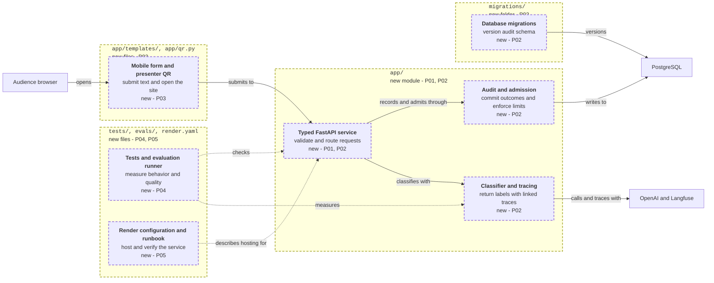

<!-- markdownlint-disable-file -->
# RPI Plan: Audience Sarcasm Detection App

## Task Metadata

* Task ID: `sarcasm-detection-app`
* Task slug: `sarcasm-detection-app`
* Plan date: `2026-11-08`
* Resolved plan: [.copilot-tracking/plans/2026-11-08/sarcasm-detection-app-plan.md](sarcasm-detection-app-plan.md)
* Starting state: No application files, manifests, tests, BRD, PRD or ADR; only completed research exists.

## Executive Summary

The plan establishes one UV-managed FastAPI web service with a phone-friendly form, the requested GPT-5.4 mini classifier, PostgreSQL/SQLAlchemy request records, Langfuse request-and-generation tracing, and downloadable presenter QR codes. Five phases establish the foundation, audited classification, audience UI, tests/evaluations, and Render delivery.

Planning execution is Complete and Planning Readiness is Ready for implementation. The standard critique completed with a Revise verdict; all eleven findings are resolved in the parent disposition without a second critique. Full-plan implementation is now Partial/Blocked for live release: P01-P04 and P05-T01 are locally complete, with 40 passing offline/PostgreSQL/browser cases and validated runtime/deployment configuration. No commit, push, production migration, deployment or paid API call was performed.

The conservative implementation contract logs metadata for every admitted HTTP request kind, retains no raw audience text by default, and keeps genuine `Unknown` classifications separate from explicit failures. Capacity/storage failures return explicit non-success without claiming an unavailable audit row exists. Local implementation and mocked checks need no deployment secrets; live quality evidence, spending authorization and final QR delivery remain clearly owned release gates.

Production rollout is initially operator-controlled with automatic deploy off, consuming passing ordinary CI and current revision-bound reviewed evaluation evidence. Preview-first database maintenance, cross-surface privacy checks, capped authorized live runs and named manual QR reading make those gates executable; actual operating values/destination/data remain user-owned.

### What You May Not Know

* Native Render UV support requires a root [uv.lock](../../../uv.lock); dependable audience hosting should not rely on sleeping/expiring free resources.
* Langfuse traces are not a durable audit store; provider output validity is not sarcasm accuracy.
* Budget, live account access, final site URL and human-reviewed evaluation targets are later release prerequisites, not facts the planner can manufacture. A complete implementation can still be honestly marked not yet deployed.
* The plan does not silently narrow "every request" to successful model calls or sample away assets/health requests. Every admitted HTTP kind receives bounded metadata records; pre-admission overload, pre-app rejection and storage failure are explicitly observable exceptions, not perfect audit coverage.

## Phase Checklist

### After

Greenfield work adds connections rather than replacing an existing path, so no Before map is warranted.



Key: arrows point from a part to what it uses; dotted arrows, tests and docs; dashed border, new; each tag names the phases that make the change.

The new mobile form and presenter QR (`P03`) reach the typed FastAPI service (`P01`, `P02`), which uses separate audit/admission and classification/tracing modules (`P02`). Database migrations (`P02`) establish persisted records; tests and evaluation tooling (`P04`) measure behavior before the Render delivery and launch gates (`P05`).

<!-- rpi:phase id=P01 -->
### [x] P01: Establish reproducible application and typed contracts

Goals:
* Make the empty repository a runnable UV project with an explicit public contract and validated operating settings.

Dependencies:
* None.

Changes in the map: Adds the typed FastAPI service foundation.

<!-- rpi:task id=P01-T01 -->
#### [x] P01-T01: Create the UV application foundation

Goals:
* The project can be installed reproducibly and started locally without contacting external providers.

Requirements:
* `FR-001`, `NFR-001`, `NFR-005`; research F1/F4 and W4/W14-W15/W30.
* Root [pyproject.toml](../../../pyproject.toml), [uv.lock](../../../uv.lock), a selected supported [.python-version](../../../.python-version), and an importable `app.main:app` agree on the tested runtime. Production sync rejects a stale lockfile and excludes dev dependencies.

Details:
* Canonical layout is [app/](../../../app/), [migrations/](../../../migrations/), [tests/](../../../tests/), [evals/](../../../evals/) and [docs/](../../../docs/); do not add a frontend runtime or agent framework.
* Use FastAPI/Uvicorn, Pydantic settings, OpenAI, Langfuse, SQLAlchemy asyncio, Psycopg 3, Alembic and Segno for their stated roles. Keep scikit-learn/evaluation tooling and pytest/Ruff in non-production groups where possible.
* Select compatible released Python and SDK versions, then lock them; upstream-main evidence is not permission to depend on mutable Git sources. Configure Ruff lint/format and pytest as the project's own checks.
* Add a secret-free environment-variable example and precise ignore rules. Settings are injectable for mocked tests; missing production secrets do not trigger live calls or a fabricated working classifier.
* Use a compatible maintained signed-cookie helper (for example `itsdangerous`) for timed opaque fairness tokens rather than inventing cryptography; keep its version in the lockfile.

References:
* [.copilot-tracking/research/2026-11-08/sarcasm-detection-app-research.md](../../research/2026-11-08/sarcasm-detection-app-research.md): research F1/F4, dependency and Render contracts.

Dependencies:
* None.

<!-- rpi:task id=P01-T02 -->
#### [x] P01-T02: Define labels, API schema and operating configuration

Goals:
* The app has one authoritative label/error contract and explicit bounded configuration.

Requirements:
* `FR-002`, `FR-003`, `NFR-002`, `NFR-003`, `NFR-005`; research F1/F2/F5.
* The following API shape is contractual, not illustrative:

```text
POST /api/classify
Input JSON: {"message": "<text>"}
200 JSON: {"label": "<one allowed label>", "request_id": "<UUID>"}
Allowed labels: Sarcasm Detected | No Sarcasm Detected | Unknown
Non-success JSON: {"error": {"code": "<stable code>", "message": "<safe text>"}, "request_id": "<UUID>"}
```

Details:
* The internal model response contains only the typed label; the application adds its request ID. No explanation or unvalidated confidence percentage is exposed.
* Default model configuration is `gpt-5.4-mini-2026-03-17` with `reasoning.effort="none"` and `store=False`; preserve the requested family. API/model substitution needs evidence and a recorded decision.
* Explicit baseline implementation assumptions are English-first, 2,000 input characters, 16 KiB request-body limit, a 20-second total classification deadline including admission/model/finalization, zero SDK retries, and four in-process model slots. These are configurable conservative starting bounds, not a promised audience SLO or approved event capacity.
* Production mode requires approved global request-window/day caps, session fairness limits, all-HTTP rate/in-flight limits, bounded audit acquisition/write timeouts, `PUBLIC_BASE_URL`, provider/database settings and a retention policy; validate ranges and dependencies at startup. Local/tests use finite synthetic bounds and clients without presenting themselves as live.
* Require injected `SESSION_SIGNING_KEY` and bounded `SESSION_TTL_SECONDS`; production refuses missing/weak/test signing material. Local/tests inject explicit synthetic settings; rotation invalidates fairness cookies without resetting persistent global model quotas.
* Assign a request ID before parsing. Stable codes map to HTTP status: `invalid_json` 400, `body_too_large` 413, `invalid_message` 422, `rate_limited` 429, `provider_refusal` 422, `provider_error`/`invalid_provider_output` 502, `request_timeout` 504, and `audit_capacity_unavailable`/`storage_unavailable`/`configuration_unavailable` 503. Framework not-found/method errors retain 404/405 with safe codes. A final audit-write failure takes precedence over returning any label.

References:
* [.copilot-tracking/research/2026-11-08/sarcasm-detection-app-research.md](../../research/2026-11-08/sarcasm-detection-app-research.md): research F1 label rubric, F2 failure separation and F5 timeout/privacy controls.

Dependencies:
* `P01-T01`.

<!-- rpi:phase id=P02 -->
### [x] P02: Make classification durable, bounded and traceable

Goals:
* A model classification is admitted safely, linked to a trace and committed as an honest audit outcome before the caller receives success.

Dependencies:
* `P01`.

Changes in the map: Completes the typed FastAPI service and adds audit/admission, classifier/tracing and database migrations.

<!-- rpi:task id=P02-T01 -->
#### [x] P02-T01: Establish the PostgreSQL audit schema and lifecycle

Goals:
* Requests and interrupted outcomes are visible in persistent storage without retaining raw audience text.

Requirements:
* `FR-004`, `FR-005`, `NFR-004`, `NFR-005`; research F2/F4/F5.
* Versioned Alembic migrations establish one request record per server-generated request UUID and indexed admission/audit fields. Reapplying the latest migration is safe; a schema mismatch blocks readiness instead of auto-creating tables.
* All admitted HTTP methods/routes, including invalid, unmatched, asset and health requests, use the same bounded metadata audit path; no request kind is exempted or sampled away. Pre-audit overload/storage failures return explicit non-success and independent diagnostics, without claiming a missing record exists. No raw query string, body, cookie, authorization value or client IP is stored by default.

Details:
* Use an app-lifetime async engine, bounded pool and independent short sessions/transactions; `postgresql+psycopg://` selects the proper async dialect. Preserve URL options and TLS requirements using SQLAlchemy URL handling, never naive credential substitution.
* Required row fields: UUID, UTC start/finalization, request kind, method and route template (safe unmatched marker), status (`pending`, `completed`, `rejected`, `failed`, `interrupted`), HTTP status and sanitized error code. Classification rows additionally carry nullable label, model/prompt/schema revision, input length, trace ID, provider response/request ID, elapsed time and available usage/cost fields.
* Commit a pending row before admitted request work, then finalize before normal response headers; no success can precede final commit. Never hold a database transaction during the OpenAI call. Persistence failure or an exhausted deadline returns non-success with sanitized independent diagnostics; an interrupted failure can leave a pending row for bounded cleanup/reconciliation rather than falsely claim finalization.
* Reconcile aged pending rows as interrupted using a configured threshold greater than the total deadline plus cleanup grace; update only stale pending rows and remain safe across repeated or concurrent runs. Cancelled requests have bounded best-effort cleanup; process death is not an exactly-once promise.
* Retention is metadata-only by default, with a provisional 30-day local parameter and an explicit user-approved production value. Expose `uv run --locked python -m app.maintenance reconcile` and `uv run --locked python -m app.maintenance purge`; both default to a bounded dry-run reporting eligible counts/cutoff, with explicit `--apply` for mutation. Reconcile changes only stale pending rows; purge deletes only policy-expired request/session/admission metadata, preserving active quota windows and gold evaluation data.
* Use database-only injected settings for maintenance, without initializing OpenAI/Langfuse clients. The operator triggers reconciliation after startup/incident and periodically according to documented pending-age checks, and purge on the documented retention schedule. First production apply follows a reviewed dry-run/cutoff and applicable backup/export policy; retained copies must follow approved retention, not preserve expired content indefinitely. No new cron service/resource is assumed.
* Producer-owned PostgreSQL cases prove preview makes no mutations, applied expiry preserves live rows/quota windows, stale reconciliation is repeat/concurrency safe and inappropriate target/configuration fails explicitly.

References:
* [.copilot-tracking/research/2026-11-08/sarcasm-detection-app-research.md](../../research/2026-11-08/sarcasm-detection-app-research.md): research F2 short transactions/interruption boundary, F4 migrations/networking, F5 privacy.

Dependencies:
* `P01-T01`, `P01-T02`.

<!-- rpi:task id=P02-T02 -->
#### [x] P02-T02: Implement the typed OpenAI classifier and Langfuse trace

Goals:
* A bounded async model call returns one allowed label or a typed failure, with useful trace/usage linkage.

Requirements:
* `FR-002`, `FR-003`, `FR-006`, `NFR-002`, `NFR-003`, `NFR-005`; research F1/F3/F5 and W28.
* The classification operation uses Langfuse `@observe()` and instrumented `AsyncOpenAI.responses.parse` under the actual locked versions. One provider call produces one generation observation, not duplicated cost accounting.

Details:
* Keep the fixed classification instruction separate from the user text; requests do not gain tools or conversation state. Unknown is abstention for insufficient context, unsupported language or conflicting cues that cannot be resolved reliably, not a fallback for refusal, incomplete response, parsing failure or timeout.
* Use `capture_input=False`/controlled output capture and export-stage filtering for provider spans. Locked Langfuse 3.15.0 lacks the newer researched hook; use public OpenTelemetry processor wrapping/ReadableSpan copies and SDK IO masking, not private SDK mutation. Preserve permitted metadata/labels and test actual exports.
* This producer owns a synthetic-marker privacy test sweeping persisted request/admission rows, captured structured/access logs and actual intercepted exported provider/decorator attributes, including failure/refusal paths. Use no audience content; verify locked SDK export behavior before asserting that the notice's app/trace retention statement is true.
* Reuse application-lifetime clients and gracefully flush Langfuse and close clients/engine on shutdown. Do not flush each HTTP request or block classification on Langfuse availability. Surface exporter/authentication degradation through structured logs/monitoring without exposing secrets.
* Carry request UUID and trace ID between the service and audit row; tag environment, deployment and prompt/schema version. Capture usage fields where returned; nullable cost/usage must not be coerced to zero. SDK `max_retries=0` makes the one-attempt baseline explicit.
* Typed refusal/error/incomplete/cancellation results must survive mapping into the API contract. A reproduced wrapper incompatibility is a demonstrated research/replanning gap, not permission for an unrecorded fallback.

References:
* [.copilot-tracking/research/2026-11-08/sarcasm-detection-app-research.md](../../research/2026-11-08/sarcasm-detection-app-research.md): research F1 schema, F3 current imports/trace nesting and F5 capture boundaries.

Dependencies:
* `P01-T01`, `P01-T02`.

<!-- rpi:task id=P02-T03 -->
#### [x] P02-T03: Connect request admission, audit and failure handling

Goals:
* Public submissions respect global bounds and return truthful outcomes even when dependencies fail.

Requirements:
* `FR-003`, `FR-004`, `FR-005`, `FR-007`, `NFR-003`, `NFR-004`, `NFR-005`; research F2/F5.
* Initial audit commit precedes classification. Finalization precedes any success headers. All parser/validation, 404/method errors and rate-limit paths are audited without reading unbounded bodies.
* Concurrent requests cannot over-reserve configured global/window/day quotas; provider calls never exceed configured in-process slots. Rejection performs no OpenAI call.

Details:
* Centralize the request lifecycle around one UUID/record so middleware, framework validation and classifier do not produce duplicate rows. The body limit applies to streamed bytes even without a trustworthy Content-Length header.
* Before database/body work, apply bounded process-wide all-HTTP rate and active-request admission under the supported single-worker topology. Do not queue unlimited audit work; promptly return `503` with stable `audit_capacity_unavailable` when saturated, without a model call or fabricated DB audit. Give every admitted HTTP lifecycle a finite deadline, preserving the 20-second classification baseline; hold/release capacity correctly through cancellation and clamp audit acquisition/writes to configured timeouts and remaining request budget. Model quota rejection remains a separate audited `429`.
* Independent diagnostics and bounded-cardinality counters expose unavailable audit/rejection counts, including non-classification flood traffic, without retaining raw paths/text or creating an unbounded logging queue. Model spend caps remain persistent/atomic; process-local HTTP admission is a throughput safeguard, not a restart-proof daily-spend counter.
* Use PostgreSQL-backed atomic short admission transactions for global quotas, counted when model execution is reserved, and do not refund attempts that may have reached the provider. Persist caps across process restarts. Reject busy capacity promptly rather than accumulate an unbounded queue.
* Single worker/instance is the supported initial topology. Transport random opaque, timed signed fairness IDs in a same-origin `Secure` (production), `HttpOnly`, `SameSite=Lax`, root-path cookie with bounded TTL; local HTTP relaxation is explicit local mode only. Invalid/expired tokens receive a new ID, not authentication authority. Persist only a purpose-derived pseudonymous quota key, never the raw cookie/signature or IP. Global caps remain authoritative when sessions reset; no venue-IP-only gate.
* Producer-owned config/admission tests cover signing-key validation, cookie attributes/expiry/tampering and global quota enforcement after token reset, using synthetic keys and the shared focused files.
* The total deadline covers database admission, provider work and finalization. Cancellation must not allow unbounded cleanup or a background provider job that bypasses concurrency tracking; stale reconciliation is the honest fallback.
* Health/readiness verifies required configuration and a bounded database operation without calling OpenAI or requiring Langfuse availability. Its normal request audit remains metadata-only; a DB outage returns `503` with independent diagnostics.

References:
* [.copilot-tracking/research/2026-11-08/sarcasm-detection-app-research.md](../../research/2026-11-08/sarcasm-detection-app-research.md): research F2 audit invariant, F5 shared-IP/concurrency/health risks.

Dependencies:
* `P02-T01`, `P02-T02`.

<!-- rpi:phase id=P03 -->
### [x] P03: Deliver the audience form and presenter QR

Goals:
* Audience members can navigate from a phone, submit text and understand results or failures; the presenter can display/download a QR for the configured actual site.

Dependencies:
* `P02`.

Changes in the map: Adds the mobile form and presenter QR.

<!-- rpi:task id=P03-T01 -->
#### [x] P03-T01: Build the phone-friendly classification interface

Goals:
* A keyboard/phone user can send one message and see exactly the approved classification label or an explicit error.

Requirements:
* `FR-008`, `FR-003`, `NFR-005`, `NFR-006`; research F1/F4/F5.
* The page includes an associated message label, stated limit, submit/loading/result/error states and a visible privacy/fallibility notice. It does not expose a raw audience-message gallery.

Details:
* Serve a small server-rendered HTML page and minimal same-origin JavaScript/CSS. Escape submitted text; use text insertion rather than HTML interpretation. No permissive CORS or third-party analytics is needed.
* Browser submissions use same-origin cookie transport; JavaScript does not read or persist the HttpOnly token in page storage, request logs or the API body.
* Prevent accidental repeated UI submission while one request is active; do not call this server-side idempotency or promise exactly-once network behavior. Give timeout/retry guidance and preserve a useful request ID without leaking diagnostics.
* Keep errors out of the three-label result display. Result/error announcements, keyboard focus and narrow-screen layout must work without color being the only signal.
* Notice states English-first context limits, verified app/trace content minimization, metadata retention under configured policy, and external processing by OpenAI plus configured Langfuse metadata tracing; do not promise zero provider retention. Public release of these privacy claims waits for the `P02-T02`/`P04-T01` marker sweep and approved destination/policy in `D5`.

References:
* [.copilot-tracking/research/2026-11-08/sarcasm-detection-app-research.md](../../research/2026-11-08/sarcasm-detection-app-research.md): research F4 single-service UX and F5 data handling.

Dependencies:
* `P02-T03`.

<!-- rpi:task id=P03-T02 -->
#### [x] P03-T02: Serve presenter navigation and downloadable QR formats

Goals:
* A presenter page and SVG/PNG downloads encode exactly one configured public navigation URL.

Requirements:
* `FR-009`, `NFR-005`, `NFR-006`; research F4 and W19-W20.
* Standard QR (not Micro QR), visible white background, black modules and a four-module quiet zone encode the canonical HTTPS root/form URL in SVG/PNG. Independent decode/reachability evidence is owned by `P05-T02`, not inferred from encoder mocks.

Details:
* Suggested routes are `/presenter`, `/qr.svg` and `/qr.png`. No presenter authentication is necessary because this page exposes only the already-public site URL, not analytics, secrets or audience content.
* Validate `PUBLIC_BASE_URL` as an absolute HTTPS URL without credentials, arbitrary query/fragment or a user-controlled Host-header fallback. An absent production URL makes QR unavailable with an explicit configuration error; tests inject reserved synthetic HTTPS URLs.
* Show the readable/clickable URL beside the QR and provide downloads sized for slides/phones. Generate these deterministically with Segno; do not use a third-party QR-generation service.
* Producer-owned local tests check canonical URL selection/rejection, encoder input and SVG/PNG response/format behavior in [tests/test_web_qr.py](../../../tests/test_web_qr.py); do not label these mocked independent decoding. Manual decode uses a phone's native camera QR reader against each rendered SVG and PNG in `P05-T02`, followed by actual-site navigation from the intended network.

References:
* [.copilot-tracking/research/2026-11-08/sarcasm-detection-app-research.md](../../research/2026-11-08/sarcasm-detection-app-research.md): research F4 canonical destination and QR requirements.

Dependencies:
* `P03-T01`.

<!-- rpi:phase id=P04 -->
### [x] P04: Establish focused regression and semantic evaluation evidence

Goals:
* Ordinary behavior is verified without paid APIs, and a separate reproducible evaluator measures model quality without inventing gold labels or allowing all-abstention success.

Dependencies:
* `P02`, `P03`.

Changes in the map: Adds tests and the evaluation runner.

<!-- rpi:task id=P04-T01 -->
#### [x] P04-T01: Verify operational contracts and continuous checks

Goals:
* Targeted tests catch broken API/audit/privacy/QR behavior and required CI checks actually run.

Requirements:
* `FR-003` through `FR-009`, `FR-011`, `NFR-001` through `NFR-006`, `NFR-008`; research F2-F6.
* Mocked OpenAI and intercepted Langfuse export tests run without real credentials, network API calls or sensitive inputs. PostgreSQL-specific migration/atomic-admission tests use isolated real PostgreSQL, not SQLite as a proxy.
* A synthetic-marker sweep covers DB rows, application/access/error logs and exported decorator/provider attributes under normal and failure flows. It must pass before publishing the privacy notice; live trace evidence confirms the same masking with authorized synthetic input.
* Failure injection covers initial/final audit-write failure, interruption/cancellation, provider failure/refusal/incomplete output, exporter failure, oversize/chunked/invalid input and concurrency limits.
* Non-classification/unmatched-path flood cases verify pre-audit rejection, bounded active/write work, timely recovery and zero provider calls; ordinary invalid/rate/error cases still prove audit coverage.

Details:
* Tests are owned by the behavior-producing tasks: foundation/config (`P01`), audit/classifier/admission (`P02`), form/QR (`P03`) and scoring (`P04-T02`). This task integrates them and CI rather than postponing all tests until the end.
* Exact removals: `none`. Maximum additions: six canonical test files and 40 independently collected ordinary cases (parameterized rows count individually), plus at most two opt-in live smoke entrypoints. Reuse focused files; no blanket coverage target or duplicated constant/framework tests.
* Canonical targets: [tests/test_config.py](../../../tests/test_config.py), [tests/test_classifier.py](../../../tests/test_classifier.py), [tests/test_audit_api.py](../../../tests/test_audit_api.py), [tests/test_postgres.py](../../../tests/test_postgres.py), [tests/test_web_qr.py](../../../tests/test_web_qr.py), [tests/test_eval_metrics.py](../../../tests/test_eval_metrics.py). Test fixtures are synthetic and are not a reviewed model-quality dataset.
* Canonical targets are Python source, migration source, hand-authored templates/CSS/JS, evaluation rubric/config and project/CI config. Generated targets are [uv.lock](../../../uv.lock), schema-generated API metadata, QR image bytes and evaluation reports; never hand-edit lockfiles or generated reports.
* Checks: `uv lock --check`, `uv run --locked ruff check .`, `uv run --locked ruff format --check .`, and scoped `uv run --locked pytest`. Canonical [.github/workflows/ci.yml](../../../.github/workflows/ci.yml) has a required `checks` job that installs selected locked groups and runs ordinary checks, including real PostgreSQL checks, without live secrets.
* CI provisions an isolated PostgreSQL service and supplies `TEST_DATABASE_URL`. Local PostgreSQL checks require an explicitly isolated database URL; document an optional disposable local-container setup only when that runtime exists, without installing services or assuming permission on a shared host. Missing prerequisites fail the required job rather than silently skip it; unit-only local selections do not claim PostgreSQL coverage. Fixtures clean only a uniquely named run-owned test schema, never reset a shared/production database.
* The ordinary job must fail on zero collected required tests. Release consumes its passing result for the exact candidate revision plus the separate current passing report from `P04-T02`; success/neutral/skipped platform status alone is insufficient. Browser-layout/phone checks may be documented manual checks; do not introduce an additional browser stack solely for screenshots.

References:
* [.copilot-tracking/research/2026-11-08/sarcasm-detection-app-research.md](../../research/2026-11-08/sarcasm-detection-app-research.md): research F6 operational-versus-semantic coverage and W24 deploy gate.

Dependencies:
* `P02-T03`, `P03-T02`, `P04-T02`.

<!-- rpi:task id=P04-T02 -->
#### [x] P04-T02: Implement the classification evaluation harness and review contract

Goals:
* A versioned reviewed dataset can be scored reproducibly with Langfuse experiments and classifier-appropriate metrics.

Requirements:
* `FR-010`, `NFR-002`, `NFR-005`, `NFR-007`, `NFR-008`; research F6 and W9-W10/W21-W23/W29.
* The harness records dataset version/hash, prompt/schema/model snapshot and deployment revision; uses exact-label comparisons; and reports confusion matrix, macro-F1, per-class precision/recall/support, Unknown coverage/answered accuracy, failures, latency and available cost.
* Binary known-label examples predicted Unknown are not scored correct. Errors and unparseable outputs are not dropped from denominators. An all-Unknown classifier or empty dataset cannot pass the quality gate.

Details:
* Command surface is a UV-run evaluation module under [evals/](../../../evals/), with an explicit paid/live option, reviewed input path and enforced threshold config. Deterministic fixture tests exercise scoring and do not call themselves a model-quality run.
* Every paid invocation, including pilot/smoke/holdout, requires explicit manual `--live` selection, recorded user authorization and a supplied approved run config: maximum requests/concurrency, input/output token bounds, pricing assumptions and conservative cost-reservation ceiling. Missing/invalid authority or caps prevents dispatch. Reserve worst-case call cost before each call, count attempts that may have reached OpenAI, enforce output limits and zero retries, and stop before a cap would be exceeded. Estimates/reservations are not a guarantee of the provider invoice; missing usage remains unknown.
* Ordinary/PR CI never supplies live keys or runs paid paths; no scheduled experiment is enabled implicitly. Fixture tests exercise absent authorization/configuration and exhausted request/cost reservations using injected clients, within the locked test budget.
* Hand-author [evals/rubric.md](../../../evals/rubric.md), a typed dataset contract/validator and runner/config. No final gold dataset is generated before confirming populations/language/Unknown rubric and human sample review. Provide input format and a clearly unreviewed tiny fixture for metric tests, not a fabricated benchmark.
* Dataset rows carry stable case ID, input, exact expected label, split/group identifier, scenario tags, provenance and review state. Near-duplicates/paired paraphrases stay in the same split. Use independently reviewed/adjudicated gold, not classifier outputs.
* The shared Unknown rubric includes insufficient context, unsupported language and unresolved conflicting cues. Support straightforward cases, those abstention cases and adversarial/negation/emoji/quotation slices only where reviewed scope supports them. Validate population/slice representation and missing-class support; disclose insufficient slice sizes instead of manufacturing statistical certainty.
* Langfuse `run_experiment` handles traced bounded runs with deterministic item evaluators and aggregate metrics. Operational failures remain failed cases; SDK error isolation must not hide them from run totals or the gate. Flush at run completion.
* First pilot establishes a baseline; quality, coverage and latency thresholds must be set by the user before testing the untouched release holdout. Missing/unreviewed data or threshold config produces a non-passing, explicit gate state. No LLM-judge, RAG metrics or new hosted OpenAI Evals dependency.
* Produce a sanitized machine-readable release report carrying candidate commit, locked runtime/model/prompt/schema revisions, dataset/review and threshold hashes, denominators, run totals and explicit pass/fail. A release-check command under [evals/](../../../evals/) rejects fixture reports, missing/unreviewed data, non-passing reports and mismatched candidate/configuration hashes. Metric/regression fixtures exercise stale, absent and all-abstention report rejection without paid calls.
* Keep evaluation inputs synthetic/reviewed and permitted for export. Live audience raw content is not collected automatically to populate datasets under the metadata-only policy.

References:
* [.copilot-tracking/research/2026-11-08/sarcasm-detection-app-research.md](../../research/2026-11-08/sarcasm-detection-app-research.md): research F6 annotation, metrics, current Langfuse interfaces and Evals retirement.

Dependencies:
* `P02-T02`.

<!-- rpi:phase id=P05 -->
### [ ] P05: Make Render deployment and audience release verifiable

Goals:
* Deliver reproducible hosting instructions/configuration and, when authorized prerequisites are supplied, a tested live site with final presenter QR and monitoring evidence.

Dependencies:
* `P04`.

Changes in the map: Adds Render configuration and runbook.

<!-- rpi:task id=P05-T01 -->
#### [x] P05-T01: Define Render resources, release configuration and operations

Goals:
* The project has deployable Render configuration and a runbook covering secrets, migrations, audit retention and incident behavior.

Requirements:
* `FR-001`, `FR-011`, `FR-012`, `NFR-001`, `NFR-003` through `NFR-005`, `NFR-008`; research F4-F6.
* A native Python web service and same-region Postgres use locked UV build/runtime, explicit version selection, `0.0.0.0:$PORT`, HTTP readiness and a controlled migration gate. No embedded secrets or automatically authorized purchase.
* The documented initial topology is one web instance/one worker; resource plan and approved quotas are explicit deploy inputs. No audience-ready claim on sleeping/expiring free resources.

Details:
* Canonical files are [render.yaml](../../../render.yaml), [.env.example](../../../.env.example), [README.md](../../../README.md), and [docs/operations.md](../../../docs/operations.md). The build is `uv sync --locked --no-dev`; start is `.venv/bin/uvicorn app.main:app --host 0.0.0.0 --port "$PORT" --no-access-log`; package/group choices must make that build sufficient. Replace unfiltered raw-path/query access logs with bounded structured route-template diagnostics; document any hosting/provider logging outside app control.
* The baseline migration gate is an operator-controlled `uv run --locked --no-dev alembic upgrade head` against the approved database before web rollout, using database-only settings without provider/trace clients. Record successful migration before proceeding; do not run migrations in worker startup. Document isolated local commands and backward-compatible roll-forward/rollback limits. Platform-native automation is optional only after capability is verified and authorized, not a prerequisite assumed by this plan.
* Set OpenAI and Langfuse secret keys, Langfuse project/base URL, internal database URL, signing secret, public URL, admission limits, retention and environment/deploy revision through Render-managed configuration. Fail fast on production-incomplete settings.
* Document disabling unnecessary external database access, backup/export availability and retention policy of the selected tier, and the preview-first `app.maintenance` commands, operator-owned incident/periodic reconciliation and retention cadence. Record dry-run counts/cutoff and bounded apply outcome, target authorization and first-apply precautions; do not assume a purchased scheduler. Explain expired-copy handling and no exactly-once provider billing promise.
* Monitoring/runbook uses request and trace IDs, volume/completion/error counts, database failures/pending age, Unknown distribution, latency, available usage/cost, export degradation and dashboard access restricted to the operator. Derive reviewed quality from evaluation evidence, not Unknown drift.
* Keep automatic production deploy disabled initially. Before a manual rollout, the operator consumes the exact candidate's successful [.github/workflows/ci.yml](../../../.github/workflows/ci.yml) `checks` result and validated current release report using the `P04-T02` checker, with authorized resource/configuration inputs. Any later automatic policy must enforce both gates for that revision and be explicitly approved; Render's After CI Checks Pass alone is not that policy.
* Describe model/provider/database outage handling and pausing admissions under budget pressure. Health probes must not incur OpenAI costs. Do not write tracking-artifact paths into public documentation.

References:
* [.copilot-tracking/research/2026-11-08/sarcasm-detection-app-research.md](../../research/2026-11-08/sarcasm-detection-app-research.md): research F4 Render/QR, F5 secrets/operations and F6 CI gates.

Dependencies:
* `P04-T01`, `P04-T02`.

<!-- rpi:task id=P05-T02 -->
#### [ ] P05-T02: Verify authorized live deployment, quality and final QR

Goals:
* Authorized public deployment is verified end-to-end, with a reachable phone form, persisted classifications, linked monitoring and final navigation images.

Requirements:
* `FR-002` through `FR-012`, `NFR-002` through `NFR-008`; research F1-F6.
* Execution waits for approved resources/secrets, confirmed canonical URL, reviewed gold data/thresholds and audience load/budget settings. Absent prerequisites leave this task blocked, never checked complete.
* Evidence confirms external HTTPS access, an exact allowed live label, committed PostgreSQL record, matching Langfuse request/generation trace and usage fields, redacted trace content, and downloaded QR decode to the live URL.
* The reviewed holdout passes configured quality/coverage bars and the authorized event-shaped load run passes its SLO without quota races, hidden failures or sensitive-data retention.
* The load evidence includes bounded non-classification audit traffic and healthy recovery after overload, with explicit unavailable-audit counts; run disruptive failure/flood scenarios only against isolated authorized test resources.

Details:
* P01-P04 and P05-T01 may complete locally without this gate; that outcome is "implementation ready to deploy," not a completed deployed app. All live smoke/pilot/quality/load work uses explicitly authorized synthetic/reviewed permitted prompts and the `P04-T02` run-admission caps; the load run also has a maximum HTTP count/duration and isolated target, never arbitrary public flooding.
* Before production rollout, obtain candidate quality evidence from the locked local classifier or an isolated authorized preview, then consume the release checker/CI result and migration outcome. Do not require an already-public deployment to earn permission for the first production release. Post-rollout smoke/correlation/device checks confirm the deployed candidate; reuse its valid holdout report unless a relevant revision/configuration change invalidates it.
* Record real deployment revision, configured versions and endpoint, resource/migration outcome, request/trace correlation, evaluated data/config hashes, run totals and monitoring visibility. Record unobserved token/cost fields honestly.
* Download final SVG/PNG, render each on the presenter display and independently read both with a phone's native camera QR reader. Record device/method and decoded destination, then navigate from the intended audience network and inspect narrow-screen/keyboard/loading/error behavior. This is documented manual evidence, not a claimed automated decoder run. Deliver files or direct downloadable URLs for the actual destination.
* Confirm retention/purge and interrupted-request operation in an isolated controlled environment; do not inject destructive failures into shared/public resources. Keep subsequent rollouts operator-controlled under the same revision/report gates unless an equivalent automatic policy is explicitly authorized.

Guidance:
* [evals/contracts.py](../../../evals/contracts.py) provides `Dataset`/`RunConfig`; [evals/run.py](../../../evals/run.py) provides `check_release` and the CLI documented in [evals/rubric.md](../../../evals/rubric.md).
* [README.md](../../../README.md) and [docs/operations.md](../../../docs/operations.md) contain the existing-service configuration, operator migration, monitoring and final QR checklist. [tests/conftest.py](../../../tests/conftest.py) provides the opt-in isolated `--local-postgres` rehearsal fixtures, not production resources.

References:
* [.copilot-tracking/research/2026-11-08/sarcasm-detection-app-research.md](../../research/2026-11-08/sarcasm-detection-app-research.md): research deployment and empirical-quality limitations across F1-F6.

Dependencies:
* `P05-T01`, `P03-T02`, `P04-T02`; user-owned release inputs in `D5`, `D6`.

## User Decisions and Requirements

### Confirmed User Direction

* Create a UV Python app using OpenAI GPT-5.4 mini.
* Return exactly `Sarcasm Detected`, `No Sarcasm Detected`, or `Unknown` for completed classifications.
* Log every request in PostgreSQL using SQLAlchemy and use Langfuse's `observe` decorator.
* Deploy on Render for an audience to submit messages, with a QR code linking to the site.
* Implement appropriate industry-standard evaluations and observability.
* Current invocation requests full-plan implementation. User reports all variables set in Render and main connected to Render; no secret values, deployment URL, reviewed gold/thresholds or explicit live-run caps are supplied here.

### Planning Decisions and Feedback

| Group | Decision or feedback item | Status | Owner | Rationale or input needed | Evidence | Planning impact |
|-------|---------------------------|--------|-------|---------------------------|----------|-----------------|
| D1 | Required providers and exact labels | Confirmed | User | Original brief | Research scope | Fixed implementation boundary |
| D2 | FastAPI, Responses parsing and async Psycopg | Planned evidence-supported assumption | Planner; user retains changes | No alternate providers; local choice with researched interfaces | research F1-F4 | `P01-T01`, `P02-T01`, `P02-T02` |
| D3 | Metadata audit for all app-received HTTP; no raw prompt retention | Planned conservative assumption | Planner; user retains changes | Preserves every-request breadth without assuming permission to store free text; outage boundary explicit | research F2/F5 | `P02-T01`, `P02-T03`, `P03-T01`; change to raw retention requires revisiting privacy scope |
| D4 | Unknown abstention; technical failures remain non-success | Planned evidence-supported assumption | Planner; user retains changes | Supported output/error separation; no fabricated labels | research F1-F2 | `P01-T02`, `P02-T02`, `P03-T01` |
| D5 | Hosting/live spend, per-run request/token/concurrency/cost caps, event traffic/limits, production retention, Langfuse project/hosting region/base URL/data policy and reviewed language/gold targets | Render variables/main connection reported; remaining live inputs unverified | User | No purchase/live run authorized here; record approved run settings/pricing, resources and destination/data policy; reviewed data/thresholds and live evidence remain absent | User implementation invocation; research F3/F5/F6/D6 | Source/configuration complete; remaining live/quality gate is `P05-T02` |
| D6 | Canonical URL, phone/display access and final QR delivery | Render variables reported; endpoint/device evidence unavailable here | User/downstream | Confirm actual configured endpoint and authorized deployment; native camera reading remains the manual independent check | User implementation invocation; research D7 | `P03-T02` passes injected URL/format tests; actual delivery/scanning remains `P05-T02` |
| D7 | Standard critique | Workflow default, not a user answer | Planner | No skip/deep request; one standard assessment | rpi-plan contract | Critique Disposition |
| D8 | Local bounds, topology and test budget | Planner-selected assumptions | Planner; user retains changes | English-first/2,000 characters/16 KiB/20 seconds/zero retries/four model slots, single worker, provisional 30-day retention, six files/40 ordinary cases/two live entrypoints are conservative project choices, not industry/event targets | Local planning judgment constrained by research F2/F5/F6 | `P01-T02`, `P02-T01`, `P02-T03`, `P04-T01`; finite audit/cleanup settings selected and tested locally, production values remain `D5` |

Participation: `user-owned`, from standalone RPI. Autopilot prevents waiting for user input; supported conservative implementation assumptions in `D2`-`D4` are not fabricated user confirmations. Unsupported business settings and final gold-data approval are explicit release inputs. No acknowledgment walkthrough is required; a later divergent requirement uses the user's retained decision ownership before affected work resumes.

## Planning Readiness and Next Step

| Field | Record |
|-------|--------|
| Planning execution and readiness | Complete execution; Ready for implementation |
| Implementation execution | Partial/Blocked for declared full plan; P01-P04 and P05-T01 locally complete; P05/P05-T02 unchecked |
| Decision participation | user-owned; standalone plus autopilot no-interaction constraint |
| Blockers | None to implementation of foundation/harness/configuration; `D5`/`D6` block paid/live/public-release work |
| Latest critique | [.copilot-tracking/reviews/plans/2026-11-08/sarcasm-detection-app-plan-critique.md](../../reviews/plans/2026-11-08/sarcasm-detection-app-plan-critique.md): Complete execution, original Revise verdict; all eleven parent dispositions resolved |
| Relevant research | [.copilot-tracking/research/2026-11-08/sarcasm-detection-app-research.md](../../research/2026-11-08/sarcasm-detection-app-research.md) |
| Plan | [.copilot-tracking/plans/2026-11-08/sarcasm-detection-app-plan.md](sarcasm-detection-app-plan.md) |
| Changes record | [.copilot-tracking/changes/2026-11-08/sarcasm-detection-app-changes.md](../../changes/2026-11-08/sarcasm-detection-app-changes.md) records ten completed tasks, final local checks and live blockers |
| Continuation owner | User; no automatic RPI parent |
| Required gates or confirmations | Standard critique/dispositions and artifact checks complete; no follow-up critique required. `D5`/`D6` block live runs/public release, not mocked source/harness work; gold review is evaluation-specific, not a generic plan signature |
| Next action | User/operator clears P05-T02 inputs, hosted candidate CI and authorized quality/migration/deployment/trace/load/device gates using the completed runbooks; no full-plan Review handoff yet |

## Goals

* A usable phone-first demonstration with a small, typed three-label output.
* Traceable and durable outcomes without leaking audience prompts or credentials.
* Measurable classification, robustness and operational behavior.
* Reproducible Render deployment and a QR that reaches the actual site.

## Scope and Non-Goals

### In Scope

* Application, database migrations, public form, tracing, request admission, QR serving, focused tests, evaluation harness, CI, Render configuration and launch documentation.

### Non-Goals

* Agent tools, RAG, a separate SPA, model training, alternate providers, public prompt history, account creation or purchasing resources during implementation without user approval.
* Planning did not create production source or resources. Implementation creates source/configuration/evidence, not fabricated reviewed gold or unauthorized live resources.

## Functional Requirements

* `FR-001`: UV-managed Python application runs reproducibly locally and on Render with versioned dependencies and explicit runtime.
* `FR-002`: A completed OpenAI GPT-5.4 mini classification returns exactly one of the three specified labels from a typed schema.
* `FR-003`: Invalid/oversized input, limit rejection, refusal, provider/output failure, timeout and storage failure return explicit non-success responses with a safe code and request UUID; never become semantic Unknown.
* `FR-004`: Every admitted HTTP kind receives one bounded PostgreSQL/SQLAlchemy audit record when storage is available, including rejected and non-classification traffic; no success precedes finalization. Pre-audit overload, pre-app rejection, deadline interruption and storage outage are explicit diagnostic boundaries, never fabricated audit coverage.
* `FR-005`: Failed/interrupted outcomes remain discoverable, stale pending rows reconcile safely and expired app/admission metadata can be purged according to configured retention.
* `FR-006`: Langfuse `observe` spans and instrumented OpenAI generations link classifications to request IDs, model/version, timings, sanitized failures and available usage/cost.
* `FR-007`: Server-side body/character limits, all-HTTP rate/capacity admission, atomic model quotas, session fairness and model concurrency prevent unbounded public use without venue-IP-only blocking.
* `FR-008`: A phone/keyboard-friendly form supports submission, pending, exact-label results and distinct accessible errors with privacy/fallibility notice.
* `FR-009`: A presenter page and downloadable standard QR SVG/PNG encode only the verified configured canonical HTTPS navigation URL.
* `FR-010`: A reproducible Langfuse-backed evaluation harness validates reviewed inputs and reports exact-match/classification/abstention/robustness/operational metrics with enforced explicit quality gates.
* `FR-011`: Required ordinary CI checks actually execute; deployment gating does not treat missing data or skipped quality evidence as a passing release evaluation.
* `FR-012`: Render configuration and operations guidance cover database/migrations/secrets/readiness/retention/monitoring, followed by authorized end-to-end live evidence and final QR delivery.

## Non-Functional Requirements

* `NFR-001`: Reproducibility.
  * Condition: `uv lock --check`, locked lint/format/tests and production `uv sync --locked --no-dev` succeed under the selected runtime; deployment does not resolve unrecorded versions.
* `NFR-002`: Output and semantic correctness.
  * Condition: 100% of successful classifications obey the exact label contract. Semantic quality requires reviewed pilot/holdout thresholds, including coverage; schema validity alone is insufficient.
* `NFR-003`: Bounded public operation.
  * Condition: Baseline configurable 16 KiB streamed-body/2,000-character limits, 20-second total classification deadline, zero retries and four model slots are enforced in targeted tests. All-HTTP admission and audit timeouts prevent unbounded queues/DB work; persistent model caps remain atomic under concurrent/restarted admissions. Event SLO/capacity is approved and measured before release.
* `NFR-004`: Audit reliability.
  * Condition: No success is sent before final database commit. Failure injection proves no duplicate rows, no fabricated persistence and safely reconciled interruptions; database transactions are not held during model latency. Independent capacity/storage-failure counts make unavailable audit coverage visible.
* `NFR-005`: Data minimization and secret handling.
  * Condition: No raw audience text, authorization, credentials, cookies, client IP or query strings are retained by default in DB, traces or application logs; one synthetic-marker sweep inspects DB, logs and actual exported provider/decorator paths. Public privacy claims wait for passing evidence and approved destination/policy; provider/hosting retention is disclosed, not falsely eliminated. Secrets stay in ignored local or Render-managed configuration.
* `NFR-006`: Usability and QR reliability.
  * Condition: Submit/result/error flows work by keyboard and at phone viewport widths; notices/errors do not rely only on color. Both QR formats independently decode to the configured URL; final phone scan reaches the actual form.
* `NFR-007`: Honest evaluation.
  * Condition: Reviewed versioned inputs, explicit denominators and separate held-out data prevent missing cases, failures or all-abstention from producing a passing result. No self-generated gold, unsupported probability metrics or invented industry threshold.
* `NFR-008`: Verification evidence and scope.
  * Condition: Focused regression checks, isolated PostgreSQL checks, separate reviewed live semantic/load runs and deployment/QR evidence identify command/run/version and result. Current-request tasks remain unchecked until their requirements have evidence; no production spend/network smoke is inferred from mocked tests.

## Risks and Open Questions

| Priority | Type | Item | Affected work | Impact | Smallest action or evidence needed | Owner |
|----------|------|------|---------------|--------|------------------------------------|-------|
| High | Release prerequisite | Render variables/main link reported; authorized access, endpoint and approved event/run inputs unobserved | `P05-T02` | Cannot claim audience release | Record approved operating inputs/access, hosted candidate CI and observable endpoint/release evidence | User/operator |
| High | Release prerequisite | Reviewed gold labels/language scope and pre-holdout thresholds missing | `P04-T02`, `P05-T02` | Harness can work; model-quality gate must not pass | Confirm evaluation scope, review/adjudicate pilot and approve bars | User/evaluation |
| High | Risk | Literal every-request audit is impossible during storage outage or pre-app rejection | `P02-T01`, `P02-T03` | Missing record must not look like success | Enforce failure boundary and test pending/finalization/independent logs | Implementer |
| High | Risk | All-HTTP audit adds DB writes for assets/health and may become an abuse load | `P02-T03`, `P05-T02` | Storage throughput constrains event capacity | Pre-audit rate/in-flight limits, timeboxed writes and isolated flood/recovery evidence; explicit rejection counts, no silent exemptions | Implementer/operator |
| Medium | Risk | HTTP/model cancellation outlives deadline or final audit cleanup | `P02-T03`, `P04-T01` | Slot/audit leaks or hidden success | Bounded cleanup, stale reconciliation and interruption-focused tests | Implementer |
| Medium | Risk | Current Langfuse source differs from installed SDK or export masking | `P02-T02` | Missing traces or raw prompt export | Verify locked async parse nesting and actual sanitized exporter attributes | Implementer |
| Medium | Risk | Session resetting evades fairness; multi-instance topology exceeds slots | `P02-T03`, `P05-T01` | Misleading public quota guarantee | Global DB quota remains authoritative; restrict and document one-worker topology | Implementer/operator |
| Medium | Risk | Migration or rolling rollback assumes destructive compatibility | `P05-T01` | Interrupted deployment/data loss | Plan-compatible single migration gate and documented compatibility boundary | Implementer/operator |
| Low | Assumption | Metadata-only logging/English-first default could differ from user expectation | `P01-T02`, `P02-T01`, `P04-T02` | Requires updated privacy/rubric if direction changes | Expose assumptions in docs; record any subsequent explicit change before affected work | User/planner |
| Low | Preview limitation | Mermaid light/dark layout not rendered in this terminal | Plan map | Diagram visual overlap unverified | Inspect a capable preview if available; structural/source map check still required | Planner |

## Dependencies

* Research facts and proposed directions provide the foundation; do not repeat provider research without a demonstrated gap.
* Actual runtime/package compatibility, PostgreSQL failure semantics and trace exports require implementation-time verification.
* Isolated PostgreSQL instance/service for migrations and atomic admission checks; do not use shared databases or install/delete broad system resources without need.
* Human-reviewed evaluation scope/data and threshold config are inputs to live quality release, not obstacles to writing the harness.
* Approved Render/provider/Langfuse access and event parameters enable `P05-T02`; credentials never enter plan/evidence.
* Implementer may resolve local file layout, compatible SDK pins, small helpers and fixture arrangements without adding providers or changing public/data contracts.

## Sources

* Original audience-app brief, completed `/rpi-plan` and current `/rpi-implement` invocation: authoritative full implementation scope and reported Render setup.
* [.copilot-tracking/research/2026-11-08/sarcasm-detection-app-research.md](../../research/2026-11-08/sarcasm-detection-app-research.md): research F1-F6, D1-D7, W1-W30.
* Business-source search: repository-root glob for `.adr-config.yml`, Markdown filenames and frontmatter/heading search for `brd_id`, `prd_id`, status/supersession and sarcasm/requirements/architecture terms; only research matched. No relevant business sources found, no source identifiers or approval status fabricated.
* Extensions: shared Copilot tracking/location instructions apply to plan and critique. Available functional/backlog planning skills require PRD/tracker scope and are skipped. Existing evaluation-design guidance informs metric/human-gold boundaries; no dataset-generation workflow invoked. Other lifecycle skills are excluded except the required embedded plan critique. No planning-extension subagent is needed to repeat adequate research.

## Critique Disposition

* Critique setting and provenance: `standard`; skill default, no user skip or deep request.
* Critique status: `Complete`.
* Latest critique and verdict: [.copilot-tracking/reviews/plans/2026-11-08/sarcasm-detection-app-plan-critique.md](../../reviews/plans/2026-11-08/sarcasm-detection-app-plan-critique.md); `Revise` at assessment, all eleven findings resolved by direct parent corrections below. Original critique remains unchanged; no second critique was run or required. Four lenses ran as parallel read-only custom critics; Coverage low, other lenses medium from standard defaults.
* Earlier critiques: None.
* Limitations: No run limitation. Diagram source/part/tag/arrow checks passed; light/dark rendering was not available. Draft blocks, links and task dependencies passed a structural check before activation.
* Test contract locked before critique: `P04-T01` owns integration of producer-owned tests; removals `none`; maximum six canonical test files/40 collected ordinary cases and two opt-in live entrypoints. Canonical/generated ownership and regression-versus-semantic evidence are fixed in `P04-T01`, `P04-T02` and `NFR-008`.

| Finding | Disposition | Action owner | Exact resolving evidence | Decision route | Plan response or residual risk |
|---------|-------------|--------------|--------------------------|----------------|--------------------------------|
| `PC-001` High | resolved | Planner | `P04-T01` names [.github/workflows/ci.yml](../../../.github/workflows/ci.yml)/`checks`; `P04-T02` rejects missing/stale/non-passing reports; `P05-T01`/`P05-T02` consume both with auto-deploy off | Direct correction | Later automation requires an approved equivalent policy; no skipped-quality pass |
| `PC-002` Medium | resolved | Planner | `P02-T02`/`P04-T01` own cross-surface marker checks; `P03-T01`/`NFR-005` gate privacy claims; `P05-T01` disables raw access logs; `D5` requires approved Langfuse destination/policy | Direct correction | Actual locked export and live verification remain implementation/release evidence, not claimed completed tests |
| `PC-003` Medium | resolved | Planner | `P02-T01` names preview-first reconcile/purge/`--apply`, DB-only settings, bounded mutations/tests and operator cadence; `P05-T01` owns runbook/first-apply policy | Direct correction | Production retention/cadence is an approved operating input; no unapproved scheduler or indefinite backup retention |
| `PC-004` Low | resolved | Planner | `D7` separates workflow-default critique; `D8` explicitly owns numerical bounds/topology/test-budget as planner choices; `D5` remains production approval | Direct correction | No local number is claimed to be user-approved, an industry standard or event SLO |
| `PC-005` Low | resolved | Planner | `P02-T02` and `P04-T02` preserve research F1's unresolved conflicting-cue Unknown rubric | Direct correction | Review/adjudication still owns gold; technical failures remain explicit errors |
| `PC-006` Medium | resolved | Planner | `P05-T01` uses locked operator-run Alembic before rollout with DB-only settings and recorded success, never worker-startup migration | Direct correction | Optional platform automation requires separately verified capability/authorization; no research blocker |
| `PC-007` Medium | resolved | Planner | `P03-T02` distinguishes encoder/format tests from `P05-T02` native phone-camera reading of each rendered format, recorded method/URL/navigation; `D6` names device access | Direct correction | No new decoder dependency; real decoding/reachability is manual release evidence |
| `PC-008` Medium | resolved | Planner | `P01-T01`/`P01-T02` name maintained signing/config; `P02-T03` defines timed secure HttpOnly SameSite transport/derived quota keys and tests; `P03-T01` uses same-origin cookies | Direct correction | Fairness is not authentication; reset/rotation does not bypass persistent global model limits |
| `PC-009` Medium | resolved | Planner | `P04-T01` provisions a CI PostgreSQL service/`TEST_DATABASE_URL`, requires isolated local targets and run-owned teardown, fails missing prerequisites | Direct correction | Local unit-only checks are not PG evidence; no unapproved host service installation |
| `PC-010` High | resolved | Planner | `P01-T02`, `P02-T01`/`P02-T03`, `FR-004`/`NFR-003`/`NFR-004`, `P04-T01` and `P05-T02` define/test bounded pre-audit rate/capacity/timeouts and truthful failure counts | Direct correction | All admitted HTTP kinds remain audited; pre-admission/storage gaps cannot be exactly-once guarantees |
| `PC-011` Medium | resolved | Planner | `P04-T02` gates all paid paths on manual selection/user authority/approved caps and pre-call reservations; `P05-T02` applies bounds to smoke/load; `D5` retains approval and PR CI stays offline | Direct correction | Cost reserves are conservative estimates, not guaranteed invoices; no implicit paid pilot |

## Artifact Self-Check

* Five phases and eleven unique task markers/headings; ordered task blocks and phase goals/dependencies/map lines present. All twelve functional/eight nonfunctional requirements have task coverage.
* Task dependency graph is acyclic; `P04-T01` consumes the evaluator and P05 release consumes required tests without a first-production quality/deployment cycle.
* Existing artifact links resolve from this plan; created canonical paths are linked. No fabricated business sources or production approval claims.
* After map has matching parts/phase tags, actor-directed edges, marked new borders and accessibility text. Source/structure checked; light/dark visual rendering was unavailable and is not claimed.
* Complete standard critique has four completed lenses; all eleven findings are preserved/resolved, including both High findings. Executive summary/readiness/release conditions agree.
* Scope check: source, lock, migrations, UI/QR, tests/evaluator, CI, Render reference, runbooks and changes record now exist. Ten task markers match evidence; no commit/push, infrastructure purchase, production migration/deploy, paid run or reviewed dataset was created.

## Follow-Up Items

* None.

## Handoff

* Declared full-plan implementation result is Partial/Blocked for live release. [.copilot-tracking/changes/2026-11-08/sarcasm-detection-app-changes.md](../../changes/2026-11-08/sarcasm-detection-app-changes.md) records P01-P04 and P05-T01 locally complete, 40 passing cases and successful lock/lint/format/runtime/schema checks.
* User/operator owns P05-T02: provide reviewed gold/thresholds, approved run/load/resource inputs and endpoint/access; publish the exact candidate without implicit production deployment, consume actual hosted CI/quality/migration gates, then verify live audit/trace/load and both QR phone scans.
* Full-plan Review is not ready while P05-T02 is unchecked; no standalone Review invoked. Business Alignment and unrelated follow-up items are None.
