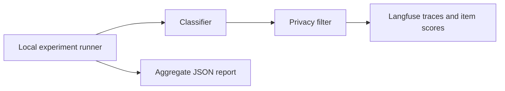
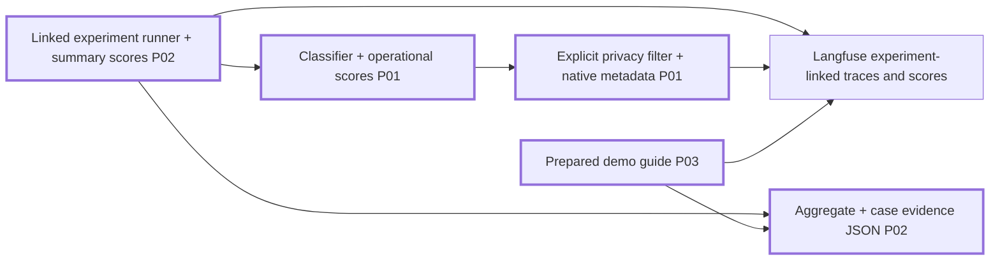

# Langfuse observability plan

## Task Metadata

Task: `langfuse-observability`. Date: 2026-11-10. Automatic, agent-owned decisions.

## Executive Summary

Make model runs diagnosable and evaluations useful in Langfuse without storing audience messages. Add runtime contract/abstention/latency signals, native trace metadata and validation spans, experiment linkage, persisted aggregate scores and case-level report evidence. Include a short prepared-demo walkthrough.

### What You May Not Know

Local-data experiment aggregate scores currently are not persisted by the locked SDK. Export filtering currently removes experiment linkage. Runtime success is not correctness; no automated semantic-accuracy claim is possible without reviewed labels.

## Phase Checklist

### Before

### After

<!-- rpi:phase id=P01 -->
### [x] P01: Operational tracing

Goals: Explain how each model attempt behaved without exposing text.
Dependencies: None.
Changes in the map: Classifier and privacy filter.

<!-- rpi:task id=P01-T01 -->
#### [x] P01-T01: Instrument classification outcomes and export safe native metadata

Goals: Visible request/release/prompt linkage, validation timing and runtime signals.
Requirements: FR-001, NFR-001, NFR-002.
Details: Keep one provider attempt. Unknown is successful abstention, not failure. Explicitly allow safe experiment linkage and resource attributes; no arbitrary metadata or prefix wildcard. Scores contain only fixed names/numeric values; no truth/accuracy scores on audience traffic.
References: [app/classifier.py](../../../app/classifier.py), [app/tracing.py](../../../app/tracing.py), research C1-C2.
Dependencies: None.

<!-- rpi:phase id=P02 -->
### [x] P02: Linked evaluation evidence

Goals: Show per-case and run-level quality, failure and latency evidence together.
Dependencies: P01.
Changes in the map: Experiment runner, JSON report and Langfuse score connection.

<!-- rpi:task id=P02-T01 -->
#### [x] P02-T01: Persist experiment metrics and text-free case evidence

Goals: Every case can be traced from report to Langfuse, including failures.
Requirements: FR-002, NFR-001, NFR-002.
Details: Keep exact-label scorer; add contract, abstention and latency checks. Persist aggregate numeric scores on a dedicated summary trace because local runs have no dataset run ID. Include per-class and slice metrics, failures, usage and case trace IDs in reports. Unknown cost stays absent, never zero; missing cases remain failures.
References: [evals/run.py](../../../evals/run.py), [evals/metrics.py](../../../evals/metrics.py), research C3-C4.
Dependencies: P01-T01.

<!-- rpi:phase id=P03 -->
### [x] P03: Regression evidence and talk walkthrough

Goals: Demonstrate why traces, evaluations and release gates answer different questions.
Dependencies: P01, P02.
Changes in the map: Prepared demo guide.

<!-- rpi:task id=P03-T01 -->
#### [x] P03-T01: Exercise real SDK paths offline and document the demo

Goals: Verify trace topology, safe telemetry and score persistence; provide a short prepared presentation path.
Requirements: FR-003, NFR-001, NFR-002.
Details: Extend existing tests using mocked provider/exporter/ingestion transport. Own tests in `tests/test_classifier.py` and `tests/test_eval_metrics.py`, plus the directly dependent fixture consumer in `tests/test_audit_api.py`; maximum 8 new focused cases plus existing parametrization updates, no removals. Check score HTTP bodies and span/resource metadata for private markers. Include Unknown versus provider errors and failed/missing cases. Run focused pytest, Ruff check/format and isolated full regression suite; no live calls. Disposable PostgreSQL and browser prerequisites are already installed; no shared resources are used.
References: [tests/test_classifier.py](../../../tests/test_classifier.py), [tests/test_eval_metrics.py](../../../tests/test_eval_metrics.py), [evals/rubric.md](../../../evals/rubric.md), [docs/operations.md](../../../docs/operations.md).
Dependencies: P01-T01, P02-T01.

## User Decisions and Requirements

Confirmed direction: replace the long live RPI demo with a finished app walkthrough; emphasize essential observability and evaluations.
Planning decisions: D1 resolved agent-owned, retain metadata-only export; D2 resolved, local summary trace instead of hosted dataset synchronization. No unresolved material choices or acknowledgment required.

## Planning Readiness and Next Step

Planning complete; Ready. Standard critique Complete/Pass, no findings. No business BRD/PRD/ADR exists in supplied repository evidence; the user request and current rubric are the authority.

## Goals

Make diagnosis, semantic evaluation and release policy visibly distinct and connected.

## Scope and Non-Goals

Local code/tests/docs only. No deployment, external data mutations, paid runs, prompt changes, dataset generation, new tools, probabilities or LLM judges.

## Functional Requirements

FR-001: Trace explicit success/abstention/error, validation duration, input length, model/prompt/schema/release/request linkage, and runtime contract/abstention/latency scores.
FR-002: Preserve experiment linkage; persist aggregate/per-class scores and text-free per-case trace/failure/latency/usage evidence; preserve existing release gates.
FR-003: Provide a prepared short walkthrough contrasting operations, semantic correctness and release decisions.

## Non-Functional Requirements

NFR-001: No raw messages, arbitrary metadata, secrets, exception payloads, user identifiers or fabricated cost. Test both score and span channels.
NFR-002: No retries/new paid calls; preserve labels, failure behavior, budget/review/release gates, and telemetry best-effort behavior. Offline regression coverage and existing Ruff formatting.

## Risks and Open Questions

SDK masks all metadata before export: project approved application attributes into native fields only in the sanitized copy. SDK UI behavior varies by server version; guide by trace/score names, not undocumented UI promises.

## Dependencies

Existing locked Langfuse 3.15.0, OpenAI and OTel packages; no manifest changes planned.

## Sources

[Research](../../research/2026-11-10/langfuse-observability-research.md), C1-C4 and W1.

## Critique Disposition

Setting: standard, first-task default. Execution: Complete. Verdict: Pass. Findings: none.
Residual external-delivery and real-quality limits accepted; offline tests are not live evidence.

## Artifact Self-Check

Scope, requirements, dependencies, test ownership, exact removals (`none`), maximum additions, source targets and generated report targets recorded. Canonical code is maintained directly; generated reports remain ignored under `reports/`. Semantic correctness requires operator-reviewed data; offline tests prove integration/regression behavior only.

## Follow-Up Items

* None.

## Handoff

Full implementation complete. Parent continues automatically to Review.
Changes record: [langfuse-observability-changes.md](../../changes/2026-11-10/langfuse-observability-changes.md).
