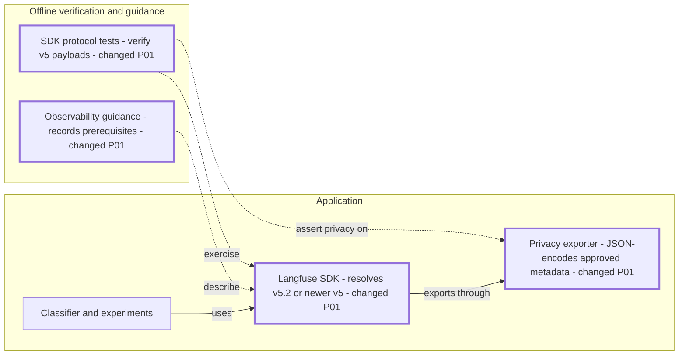

# RPI Plan: Langfuse SDK compatibility

## Task Metadata

Task ID / slug: `langfuse-sdk-compatibility`. Date: 2026-11-10. Distinct task in the existing Langfuse session.

## Executive Summary

Upgrade to Langfuse v5, preserve metadata-only tracing and report IDs, adapt offline verification to the new score protocol, and correct SDK-specific operational guidance. Planning is complete and Ready; the standard critique passed without findings.

### What You May Not Know

v5 changes custom metadata serialization and score transport beneath otherwise stable helper APIs. The source update requires deployment to affect Cloud ingestion. Self-hosted installations require server >=4.59.0.

## Phase Checklist

### After

Thick borders mark P01 changes; dotted arrows show tests/docs. Connections remain unchanged. The SDK still exports through the privacy provider; only SDK/protocol behavior changes. Diagram preview unavailable in this CLI.

<!-- rpi:phase id=P01 -->
### [x] P01: Preserve observability on the supported SDK

Goals:
* Keep existing runtime and evaluation signals available on the supported data model.

Dependencies:
* Completed research C1-C3, W1-W4.

Changes in the map: SDK, privacy exporter, protocol tests and observability guidance.

<!-- rpi:task id=P01-T01 -->
#### [x] P01-T01: Upgrade the locked SDK and metadata projection

Goals:
* Application tracing uses v5 and sends approved metadata in the correct JSON wire format.

Requirements:
* FR-001, FR-002, NFR-001, NFR-003.

Details:
* Use `langfuse>=5.2,<6` and refresh the lock with uv, avoiding unrelated upgrades.
* Encode only approved projected values using `json.dumps`; retain `sarcasm.*` types, mask, allowlists and custom provider.
* Preserve observation helper APIs and smart filtering. Inspect v5 SDK source locally if test failures reveal a changed contract.

References:
* [pyproject.toml](../../../pyproject.toml), [uv.lock](../../../uv.lock).
* [app/tracing.py](../../../app/tracing.py): `sanitized_span`.
* [.copilot-tracking/research/2026-11-10/langfuse-sdk-compatibility-research.md](../../research/2026-11-10/langfuse-sdk-compatibility-research.md): C1-C2, W2-W4.

Dependencies:
* None.

<!-- rpi:task id=P01-T02 -->
#### [x] P01-T02: Verify v5 scoring, experiments and privacy offline

Goals:
* Actual locked SDK tests prove unchanged classification outcomes and safe score/trace/report contracts.

Requirements:
* FR-002, NFR-001, NFR-002, NFR-003.

Details:
* Existing test ownership: classifier tests own provider/score/span privacy; eval tests own experiment/gate/report behavior.
* Exact removals: none. Maximum additions: two focused tests only if existing assertions cannot cover introduced behavior; prefer extending existing cases.
* Canonical targets are Python source/tests, manifest and docs; `uv.lock` is generated only by uv.
* Assert `/api/public/scores` batched body using mock transports; decode JSON metadata for semantic assertions, including numeric values and labels.
* Preserve failure/cancellation, redaction, parent/child hierarchy, summary IDs and case score linkage. Exercise native local aggregate scores and experiment-root linkage if the SDK emits them.
* Validation evidence: `uv lock --check`; `uv run --locked ruff check .`; `uv run --locked ruff format --check .`; `uv run --locked --group eval pytest tests/test_classifier.py tests/test_eval_metrics.py -q`. Run other non-database regression tests if shared SDK changes affect imports/lifecycle; use existing isolated local PostgreSQL only if broader failures require it.
* No model-quality claims from synthetic fixtures. No live endpoints or credentials.

References:
* [tests/test_classifier.py](../../../tests/test_classifier.py).
* [tests/test_eval_metrics.py](../../../tests/test_eval_metrics.py).
* [.github/workflows/ci.yml](../../../.github/workflows/ci.yml).

Dependencies:
* P01-T01.

<!-- rpi:task id=P01-T03 -->
#### [x] P01-T03: Align observability guidance with v5

Goals:
* Operators know server prerequisites, summary semantics and the distinction between local compatibility and deployed ingestion.

Requirements:
* FR-003, NFR-003.

Details:
* Correct obsolete v3-only aggregate persistence explanations without removing explicit summary/report contracts.
* Record Cloud or self-hosted >=4.59.0 requirement and the need to deploy then check new ingestion before cutoff.
* Do not claim dashboard remediation or current evaluation quality.

References:
* [docs/observability-demo.md](../../../docs/observability-demo.md).
* [evals/run.py](../../../evals/run.py): summary trace comment.
* [.copilot-tracking/research/2026-11-10/langfuse-sdk-compatibility-research.md](../../research/2026-11-10/langfuse-sdk-compatibility-research.md): C3, W2.

Dependencies:
* P01-T01.

## User Decisions and Requirements

### Confirmed User Direction

Resolve the supplied November 16, 2026 SDK compatibility warning. User chose end-to-end execution with agent-owned decisions. Local source, lockfile, tests and relevant documentation only; no deployment, credentials, live requests, commit or push.

### Planning Decisions and Feedback

D1 confirmed, agent-owned: v5.2 within a v5-only range, using Cloud default and documented self-hosted prerequisite. D2 confirmed: preserve approved-only metadata and summary/report semantics. No unresolved material choices or additional walkthrough.

## Planning Readiness and Next Step

Research Ready; planning Complete and Ready. [Critique](../../reviews/plans/2026-11-10/langfuse-sdk-compatibility-plan-critique.md) execution Complete, verdict Pass, zero findings. No blockers. Automatic parent owns continuation to Implement. Plan path is this file; implementation evidence will be `.copilot-tracking/changes/2026-11-10/langfuse-sdk-compatibility-changes.md`. No named human-review requirement applies to local edits.

## Goals

Compatible SDK ingestion without changing classification, abstention/error semantics, privacy or evaluation gates.

## Scope and Non-Goals

Dependency manifest/lock, approved metadata projection, SDK protocol tests and affected guidance. No new infrastructure, hosted datasets, raw text telemetry or unrelated cleanup.

## Functional Requirements

* FR-001: Resolve and lock a v5 SDK supporting the new data model.
* FR-002: Preserve approved metadata, generation/root/validation hierarchy, scores and experiment/report linkage using v5 contracts.
* FR-003: Explain SDK/server prerequisites, preserved summary semantics and deployment/ingestion limits accurately.

## Non-Functional Requirements

* NFR-001: No raw input/output, arbitrary metadata, exception text or secrets in exported spans, scores or reports.
* NFR-002: Offline actual-SDK success, abstention, error, cancellation and experiment paths pass; lock, Ruff lint and formatting checks pass.
* NFR-003: No paid calls, live telemetry, shared-database mutations or unrelated lock upgrades.

## Risks and Open Questions

Native local experiment scores may add experiment-root spans. P01-T02 must verify actual v5 output and preserve useful linkage without admitting arbitrary metadata. Live delivery remains operator-owned after deployment, outside local acceptance.

## Dependencies

Published v5.2.0, Python 3.12 and existing uv tooling. No new test tooling.

## Sources

* [.copilot-tracking/research/2026-11-10/langfuse-sdk-compatibility-research.md](../../research/2026-11-10/langfuse-sdk-compatibility-research.md): C1-C3, W1-W4.
* [pyproject.toml](../../../pyproject.toml): dependency and check configuration.
* [.github/workflows/ci.yml](../../../.github/workflows/ci.yml): repository commands.
* BRD, PRD and ADR: none supplied or discovered by filename search; the user warning and research are the authority.

## Critique Disposition

Standard, first-task default; Complete, Pass, zero findings. Output: [.copilot-tracking/reviews/plans/2026-11-10/langfuse-sdk-compatibility-plan-critique.md](../../reviews/plans/2026-11-10/langfuse-sdk-compatibility-plan-critique.md). Direct critique, no subagents. No earlier critique or unresolved dispositions.

## Artifact Self-Check

Executive summary, current user direction, goals, requirements coverage, task markers/blocks, map, dependencies, test ownership and bounded additions, sources, risk owners, follow-up exclusions, critique disposition and readiness checked. Preview limitation recorded.

## Follow-Up Items

* None.

## Handoff

Full-plan implementation complete. [Changes record](../../changes/2026-11-10/langfuse-sdk-compatibility-changes.md) contains completed outcomes and validation. Automatic parent proceeds to Review; no unresolved local work.
